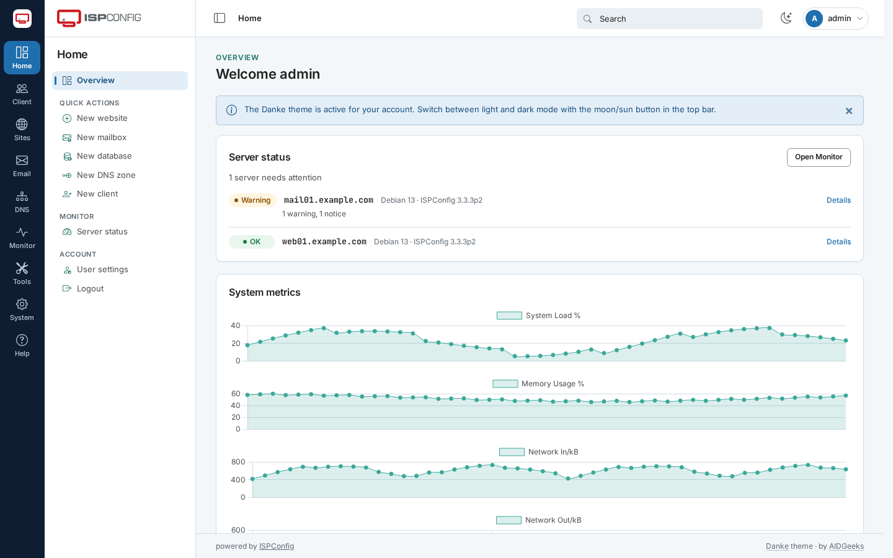
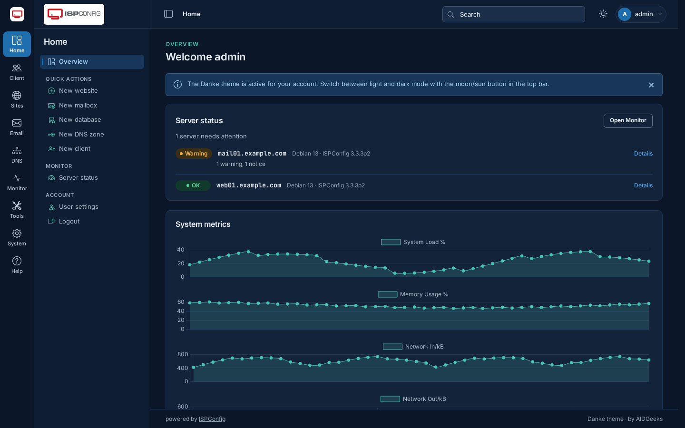
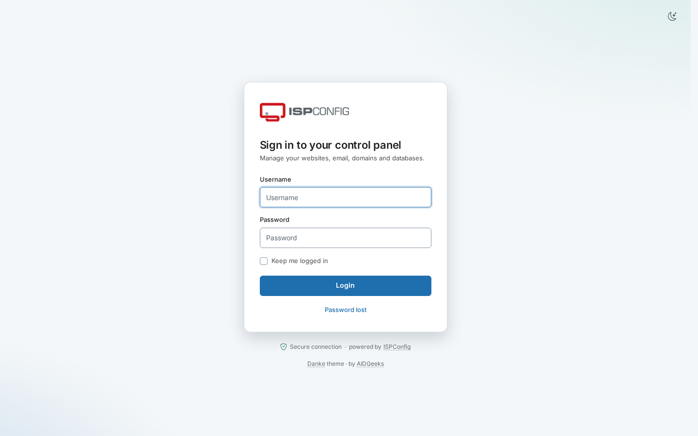
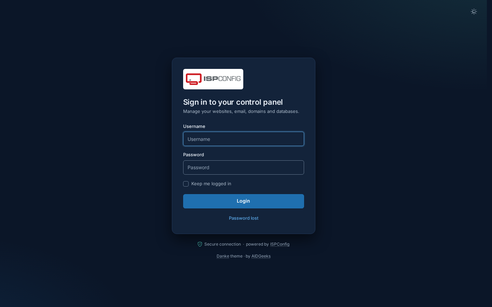

# Danke

**Danke, a modern theme for ISPConfig, by AIDGeeks.**

<!-- mascot: an owl. The artwork is not made yet — the slot is docs/mascot/ (see docs/mascot/README.md).
     When owl.svg exists, put this line here:   -->

*Danke* is German for "thank you" — a thank-you to the ISPConfig team for a control panel that so many of us run
our servers with. Danke gives ISPConfig 3.3 a calm, modern interface: an icon rail with a module menu, a real
breadcrumb, light and dark mode, readable tables on phones, a dashboard that shows server status at a glance —
without changing a single file of ISPConfig.

| Light | Dark |
|---|---|
|  |  |
|  |  |

More screenshots: [list](docs/screenshots/list-light.png) · [form](docs/screenshots/form-light.png) ·
[DNS records](docs/screenshots/dns-light.png) · [Monitor](docs/screenshots/monitor-light.png) ·
[client dashboard](docs/screenshots/dashboard-client-light.png) · [phone, 390 px](docs/screenshots/dashboard-admin-light-390.png) ·
[with a company name and a stored custom logo](docs/screenshots/dashboard-custom-logo-light.png)
(all in `docs/screenshots/`, light and dark).

## What it is — and what it is not
- **One folder.** The theme is `interface/web/themes/danke`. Nothing else in the ISPConfig installation is changed:
  no core file, no template outside the theme, no language file, no database table. Remove the folder and ISPConfig
  is exactly as before.
- **ISPConfig's own code stays ISPConfig's.** The pages load ISPConfig's JavaScript from the `default` theme of your
  installation, so it always matches the installed release. Every form, list and function is the original one.
- **Nothing from the internet.** Fonts (Inter, JetBrains Mono) and icons are inside the theme. No CDN, no web fonts,
  no tracking.
- **Your panel, your brand.** Out of the box the panel shows what *your* ISPConfig installation has: ISPConfig's
  logo and the company name you set in ISPConfig. Your own logo, name and colour accent go into a small `local/`
  folder that survives every update — see "Branding in 2 minutes".
- **Per user.** Each user chooses the theme under *Tools → User Settings → Design*. Try it with one account;
  everybody else keeps the default theme.
- English and Portuguese for the theme's own few texts; everything else is in the language ISPConfig is set to.

## Requirements
- ISPConfig **3.3.x** (tested: 3.3.3p2, 3.3.2p1, 3.3.1p1 — see `theme/danke/TESTED-VERSIONS.md`). Other major.minor
  versions are refused by the installer, as ISPConfig itself would refuse the theme.
- Root access to the panel server for the installation. A current browser.

## Get it
Everything is in this repository: **https://github.com/aidgeeks/danke-ispconfig-theme** — the theme (`theme/danke`), the
scripts (`install/`), this README and [`INSTALL.md`](INSTALL.md). Each release is a tag (`v1.0.0`, …); the
[changelog](#changelog) below says what a release contains.

## Install
```bash
# on the panel server, as root
git clone https://github.com/aidgeeks/danke-ispconfig-theme.git
cd danke-ispconfig-theme
./install/install-theme.sh --dry-run theme/danke      # shows the plan, changes nothing
./install/install-theme.sh theme/danke
```
No git on the server? Download the release as an archive on your workstation, copy the folder to the server and
run the same two commands in it. If you were given a package file instead (`danke-theme-….tar.gz` with its
`.sha256`), check it with `sha256sum -c danke-theme-*.tar.gz.sha256` and pass the file in place of `theme/danke`.
The examples below call the scripts `./install-theme.sh`, `./set-user-theme.sh` and `./uninstall-theme.sh` — they
are the ones in `install/`.

Then log in, open *Tools → User Settings*, set **Design** to `danke` and save — the page reloads with the theme.
The installer backs up what it replaces, never edits `config.inc.php` and never writes to the database.
Full guide — per-user test, making it the default for everybody, version notes: [`INSTALL.md`](INSTALL.md).

## Making Danke the default
The global default theme (`$conf['theme']`) decides the **login page** and the theme of users created from now on.
After you tested with one user, the optional helper sets it — a **dry run unless you add `--apply`**:
```bash
./set-user-theme.sh --set-default danke              # shows the current and the new line of both config files
./set-user-theme.sh --set-default danke --apply      # asks for yes; backup to /root/danke-config-backup-<timestamp>/
./set-user-theme.sh --set-default default --apply    # back to ISPConfig's theme — do this before an uninstall
```
It changes only the line `$conf['theme'] = '…';` in `interface/lib/config.inc.php` and `server/lib/config.inc.php`
(owner and mode kept, diff and restore commands printed), refuses a theme that is not installed or not compatible,
and says "already set" when there is nothing to do. ISPConfig's updater keeps the value. Doing the edit by hand is
described in [`INSTALL.md`](INSTALL.md), step 6.

## Switching existing users
- `$conf['theme']` in `config.inc.php` sets the **login page** and the theme of users created **from now on**. It
  does not switch anybody who already exists.
- The **Design** field in *Client → Edit Client* works only when a client is **created**. For an existing client
  ISPConfig stores the value but the login keeps the old theme (ISPConfig 3.3.1p1 – 3.3.3p2,
  `client/client_edit.php`: the update copies user name, password, language and modules to the login user, not the
  theme).
- What does switch an existing user: the user's own *Tools → User Settings → Design*; the admin via "login as" and
  the same form; or the helper below.
- If a user's stored theme was removed, the Design list shows the **first** theme as if it were selected — nothing
  is set until that user saves.

`install/set-user-theme.sh` is a separate, optional admin tool (root, on the panel server). It reads ISPConfig's own
database credentials, for users touches only `sys_user.app_theme` and `client.usertheme`, and is a **dry run unless
you add `--apply`** (which first writes a `mysqldump` of both tables to `/root/` and asks for `yes`; the dump needs
no LOCK TABLES privilege):
```bash
./set-user-theme.sh --list                                   # who is on what; MISMATCH = Edit Client says one theme, the login uses another
./set-user-theme.sh --sync-from-client                       # dry run: login theme := the client's Design
./set-user-theme.sh --sync-from-client --apply
./set-user-theme.sh --set danke --users alice,bob --apply    # or --clients-only, or --all
./set-user-theme.sh --set default --all --apply              # everybody back to ISPConfig's theme
./set-user-theme.sh --sync-from-client --set-default danke --apply     # users and the global default in one run
```
Details and exit codes: [`INSTALL.md`](INSTALL.md) → "Switching existing users".

## Update
Install the new release the same way (`git pull` in the clone, then `./install/install-theme.sh theme/danke`). The
previous folder is backed up to `/root/danke-theme-backup-<timestamp>/`, your `local/` folder (brand choice, own
logo) is carried over. Every file the theme loads carries the release's version in its address, so a normal reload
shows the new release — no cache to empty by hand.
`./install-theme.sh --rollback /root/danke-theme-backup-<timestamp>` goes back.

### After updating ISPConfig itself
An ISPConfig update keeps `themes/danke` and the global default theme. Afterwards check that the login page and the
panel load (no 404 in the browser's network view), then install the current theme package once more and run
`./set-user-theme.sh --list`. The full checklist: [`INSTALL.md` → "Updating ISPConfig"](INSTALL.md#updating-ispconfig).

## Uninstall
```bash
./uninstall-theme.sh --dry-run
./uninstall-theme.sh
```
The folder is backed up, then removed. Users who had chosen `danke` get ISPConfig's `default` theme at their next
login. If you made `danke` the global default, the script stops and tells you the one line to change first
(`./set-user-theme.sh --set-default default --apply`, or `./uninstall-theme.sh --reset-default`).

## FAQ
**`https://panel.example.com:8080` fails with `SSL_ERROR_RX_RECORD_TOO_LONG` (openssl: "wrong version number").**
The host name is proxied by Cloudflare, and Cloudflare speaks only plain HTTP on port 8080. The server is fine.
Either set the panel's DNS record to "DNS only", or add an Origin Rule (host name → destination port 8080), set SSL
to "Full (strict)" and open `https://panel.example.com` without a port.

**I set Design to `danke` in *Edit Client*, but the client still gets the old theme.** See "Switching existing
users": that field only counts when the client is created. Use `set-user-theme.sh --sync-from-client`.

**I saved *User Settings* and nothing seemed to happen.** A Design change reloads the page; any other successful
save shows "Saved." at the bottom. Neither → nothing was stored; look for a red message above the form.

## Branding in 2 minutes
**A — your company name, ISPConfig's logo.** Nothing to install. In ISPConfig open System → Interface → Main Config
→ tab *Misc* and fill in **Company Name for the page title**. With the profile `neutral` (the default of this
package) the browser tab then reads "Your Company :: ISPConfig" and the footer "Your Company · powered by
ISPConfig". The logo stays ISPConfig's: ISPConfig 3.3 has no logo upload in its interface. (A custom logo stored by
an older ISPConfig version is still shown.)

**B — your own logo, icons and colour.** Your brand lives in the theme's `local/brand/` folder. Start from the
kit that comes with the theme:
```bash
./install-theme.sh --new-brand                 # copies the starter kit to themes/danke/local/brand/ — applies nothing
#   edit themes/danke/local/brand/brand.json, replace logo.svg and icon.svg (and logo-dark.svg, icon-rail.svg)
./install-theme.sh --dry-run --apply-brand     # shows what would be applied
./install-theme.sh --apply-brand               # applies it (the theme folder is backed up first)
```
The smallest brand is three files:
```
themes/danke/local/brand/
  brand.json     { "name": "Acme Hosting", "logo": "files", "accent": "#0B6E4F" }
  logo.svg       your logo, wide (about 4 : 1), for light backgrounds
  icon.svg       your icon, square — browser tab and phone top bar
```
Optional: `logo-dark.svg` (dark mode), `icon-rail.svg` (white icon on the dark rail), `"rail": "#RRGGBB"` for the
rail's background (a colour too light for the rail's text is refused). The kit's `README.md` lists the sizes and
every `brand.json` key; so does
[`INSTALL.md` → "Brand profiles"](INSTALL.md#brand-profiles--logo-name-colour-accent-credit).
`local/` belongs to your server: updates and rollbacks keep it. `--new-brand` never overwrites an existing brand.

The small credit line in the footer ("Danke theme · by AIDGeeks"; with your own brand: "Designed by AIDGeeks") can
be switched off: `"credit": false` in `brand.json`, or `echo off > themes/danke/local/credit`, then
`./install-theme.sh --apply-brand`. If you like the theme, leaving it on is a nice way to say so.
"powered by ISPConfig" — in the footer and below the login card, with ISPConfig's own link — is not part of that
switch: it always stays.

## Issues and questions
Issues and questions: the GitHub issues of this repository — https://github.com/aidgeeks/danke-ispconfig-theme/issues.
Please say which ISPConfig version you run, which theme release (the tag, or the first line of
`theme/danke/TESTED-VERSIONS.md`), the browser, and whether the problem is still there with the `default` theme.
Problems with ISPConfig itself belong to ISPConfig: its [forum and support](https://www.ispconfig.org/get-support/).

## Thanks and credits
- **[ISPConfig](https://www.ispconfig.org/)** — by Till Brehm, ISPConfig UG, and its contributors. Danke exists
  because ISPConfig does. If ISPConfig runs your servers, consider giving something back:
  [donate to the project](https://www.ispconfig.org/donation/), buy the manual, or use the
  [professional support](https://www.ispconfig.org/get-support/).
- Bootstrap and Bootstrap Icons, Font Awesome, Select2, the Inter and JetBrains Mono typefaces — details and
  licences in [`THIRD-PARTY-NOTICES.md`](THIRD-PARTY-NOTICES.md).
- Design and development: [AIDGeeks](https://aidgeeks.com).

**Danke is not affiliated with, endorsed by or supported by ISPConfig UG.** It is an independent theme. Please do
not ask the ISPConfig team for help with it — if the panel misbehaves with Danke, switch your user back to the
`default` theme first (Tools → User Settings → Design) and see whether the problem is still there.

## Changelog
| Version | Date | What |
|---|---|---|
| **1.0.0** | 2026-11-19 | First public release (package release r17). Icon rail with module menu, breadcrumb, light / dark mode, dashboards with server status, restyled lists, forms, DNS records, Monitor and login pages; brand profiles with a starter kit for your own brand; installer, uninstaller and the optional helper for the theme of existing users. Tested with ISPConfig 3.3.3p2, 3.3.2p1 and 3.3.1p1. |

The version is also what the theme prints into the address of every file it loads (`?ver=1.0.0-r17`): `r17` is the
package release the version was built from. `theme/danke/TESTED-VERSIONS.md` lists which ISPConfig versions each
release was tested with.

## Licence
MIT — see [`LICENSE`](LICENSE). Parts that come from ISPConfig (BSD 3-Clause) and other projects keep their
licences: [`THIRD-PARTY-NOTICES.md`](THIRD-PARTY-NOTICES.md).
